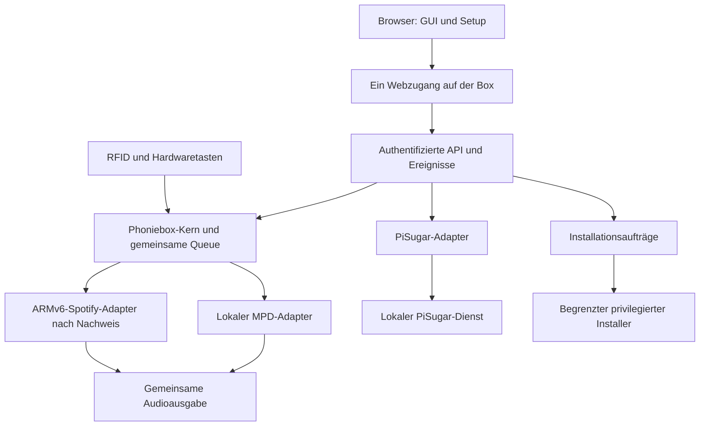

# Phoniebox: integrierte Oberfläche und Webinstallation

Stand: 16.10.2026. Zielkonzept; einzelne transportfreie Module sind inzwischen implementiert, der operative Nachweis steht in tasks/todo.md. Keine Gesamtimplementierung oder Gerätetests. Soloist-spezifische Kopplungs-/Updatehinweise unten gelten nur für künftig separat nachgewiesene passende Architekturen, nicht für den bestätigten ARMv6-Zero W.

## Ziel und Ausgangslage

Ein echter Fork von MiczFlor/RPi-Jukebox-RFID erhält eine neue Weboberfläche, einen gemeinsamen Player für eigene Dateien und Spotify, PiSugar-Verwaltung und einen Webinstaller nach einmaligem Bootstrap. Musik läuft auf der Box weiter, wenn der Browser geschlossen wird. RFID, Tasten und Web bedienen denselben Player.

Ziel ist der ursprüngliche Raspberry Pi Zero W (ARMv6) mit Raspberry Pi OS Lite 32 Bit und PiSugar 2 (2 LEDs). OS-Release, Audioausgang, Bestandsversion und separate Test-SD bleiben offen. Neuinstallation und Import erst nach Sicherung auf einer geeigneten Testressource; ein Bookworm-ARMv7-Container ist kein ARMv6-Gerätenachweis. Siehe [Hardwareprofil](../../../tasks/f04-hardware-profile.md).

Öffentliche Quellen wurden über Web gelesen. Lokales Klonen scheiterte am eingeschränkten Netzwerk; die lokale GitHub-Anmeldung ist ungültig. Genaue Code-Einhängepunkte sind am ausgewählten Release zu prüfen. Die Designgrafik war ebenfalls nicht abrufbar.

## Belegte Grundlagen

- V2 und die Python-Neuentwicklung V3 unterscheiden sich grundlegend. V3 verwendet bereits React. Quellen: [Original](https://github.com/MiczFlor/RPi-Jukebox-RFID), [Web-App-Dokumentation](https://github.com/MiczFlor/RPi-Jukebox-RFID/blob/future3/main/documentation/developers/webapp.md).
- V3 führt Spotify in der Statusdokumentation als noch nicht integriert. Quelle: [Feature Status](https://github.com/MiczFlor/RPi-Jukebox-RFID/blob/future3/main/documentation/developers/status.md).
- Die geprüfte Release-Seite zeigt v3.6.0, v3.7.0-alpha und v2.9.0. V3 empfiehlt dort Bookworm; Trixie wird vorerst ausgeschlossen. Quelle: [Releases](https://github.com/MiczFlor/RPi-Jukebox-RFID/releases).
- Spotify bietet Soloist offiziell für Linux/Raspberry Pi mit lokaler Steuerung und Einzeltrack-Modus an. Eigener API-Key, offizieller Download und Austausch der nach 90 Tagen ablaufenden Builds sind erforderlich. Binaries dürfen nicht im Fork weiterverteilt werden. Quelle: [Soloist](https://developer.spotify.com/documentation/soloist).
- Der V3-Installer lehnt erneute Installation über einen vorhandenen Bestand ab. Webinstallation und Migration benötigen einen eigenen Ablauf. Quelle: [Installer](https://raw.githubusercontent.com/MiczFlor/RPi-Jukebox-RFID/future3/main/installation/install-jukebox.sh).

Weitere Quellen und Einschränkungen: [Integrationsrecherche](../../../integration-research.md). Dokumentation ersetzt keinen Hardwaretest.

## Architekturentscheidung

| Ansatz | Nutzen | Grenze | Bewertung |
| --- | --- | --- | --- |
| V3-Fork mit vorhandenem Python-Kern und React | Gerätefunktionen wiederverwenden, langfristig erweiterbar | Spotify/Queue ergänzen, V2-Daten migrieren | Bevorzugt |
| V2-Fork mit PHP und Mopidy | Nähe zu vorhandener V2-Box | Alter Unterbau; aktuelle Spotify-Wiedergabe extra nachweisen | Alternative bei zwingender Bestandskompatibilität |
| Vollständiger Neubau neben dem Original | Freie Architektur | RFID, Audio und Geräteverwaltung weitgehend neu anbinden | Zu großer Zusatzumfang |

Empfehlung: V3 auf geprüftem stabilem Release, zuerst Kandidat v3.6.0 mit festgehaltener vollständiger Commit-ID evaluieren. Hardwareprüfung und Spotify-Versuch entscheiden endgültig. Kein ungeprüfter Entwicklungsbranch als Installationsquelle; keine parallele Pflege zweier vollständiger V2-/V3-Produkte.

Bestehenden React-Client anpassen und Python beibehalten. Gemeinsame Wiedergabesteuerung im Kern, vorhandene RPC-/Ereignisschnittstellen zuerst wiederverwenden. Authentifizierter HTTP-/Event-Zugang unter derselben Geräteadresse. Ein neues Backend-Framework ist keine Vorentscheidung. SQLite ist für neue Playlists und Laufzustand vorgesehen; vorhandene Konfigurationen nicht grundlos umziehen.



Interne Prozesse dürfen Ports oder Unix-Sockets behalten. Im Browser gibt es eine Adresse mit Unterseiten; interne Steuerdienste bleiben lokal. Das Entfernen eines sichtbaren Ports alleine erzeugt keine gemeinsame Queue.

## Oberfläche

Verbindliche gestalterische Referenz ist die [Dribbble-Grafik](https://cdn.dribbble.com/userupload/5037629/file/original-c7e28b3f83c5daa85bc0ada2bfdc4578.png). Sie ließ sich hier nicht abrufen. Farben, Schriften und Proportionen sind deshalb noch nicht analysiert. Folgende Struktur ist ein funktionaler Vorschlag, keine Beschreibung des Bildes.

| Menüpunkt | Inhalt |
| --- | --- |
| Start | Aktueller Titel, Favoriten, zuletzt verwendet, Batterie und Verbindung |
| Musik | Eigene Ordner/Titel, Upload, Suche |
| Spotify | Suche, verfügbare Playlists, Links, Anmeldung |
| Playlists | Gemischte Phoniebox-Playlists und laufende Warteschlange |
| RFID | Karten zuweisen, ändern und testen |
| Akku & PiSugar | Energiezustand, unterstützte Einstellungen, Herstelleroberfläche |
| Einstellungen | Audio, Lautstärkegrenze, Netz, Diagnose, Sicherung, Updates |

Desktop: Navigation seitlich, Suche/Akku oben, Bibliothek/Cover zentral, optional Queue rechts. Player bleibt beim Seitenwechsel sichtbar. Smartphone: einklappbare Navigation, kompakter Player und Queue als eigene Ansicht.

Kennzeichnendes Bedienelement ist die gemeinsame Liste mit verständlicher Quellenkennzeichnung. Überall dieselben Aktionen: jetzt spielen, als Nächstes, anhängen, zur Playlist hinzufügen. Nicht unterstützte Funktionen werden gezielt deaktiviert und erklärt.

Nach Sichtung der Vorlage Design-Tokens für 4–6 Grundfarben, Schriftrollen, Abstände und Rundungen ableiten. Zuerst Startseite, Playlist und Mobilansicht abstimmen. UI-Ressourcen lokal ausliefern, damit eigene Musik offline bedienbar bleibt. Tastatur, Fokus, Kontrast und Touch-Ziele gehören zur Abnahme.

## Spotify und gemischte Listen

Gemischte Listen sind **auf der Box gespeicherte Phoniebox-Playlists**. Sie enthalten lokale Medienreferenzen und Spotify-URIs. Die Web API kann keine auf dem Pi liegenden Audiodateien zu Spotify-Playlists hinzufügen. Quelle: [Spotify-Playlistkonzept](https://developer.spotify.com/documentation/web-api/concepts/playlists).

Beispiel: Begrüßung.mp3 → Spotify-Titel → Geschichte.m4a → Spotify-Titel.

Einträge besitzen stabile ID, Quelle, Referenz und Reihenfolge. Laufende Queue besitzt Revision, aktuelle Position und Wiedergabesitzung. Lokale Dateien über freigegebene Bibliotheks-IDs referenzieren; Spotify-URIs validieren. Importierte Listen sind zunächst geordnete Momentaufnahmen. Änderungen bei Spotify ändern gespeicherte Phoniebox-Listen nicht unbemerkt.

Der Koordinator verwaltet Reihenfolge, Pause, Vor/Zurück, Shuffle, Repeat, Resume und Lautstärkegrenze. RFID, GPIO und Web nutzen denselben Befehlspfad. Quellenwechsel: bisherigen Anbieter stoppen, Bestätigung abwarten, nächsten starten. Verspätete Ereignisse einer alten Sitzung dürfen keinen weiteren Wechsel auslösen. Stop, Skip, natürliches Ende und Fehler unterscheiden.

Die frühere Soloist-Präferenz gilt für diese Zielbox nicht: Die offizielle Downloadmatrix enthält keinen ARMv6-Build. Ein alternatives Backend wird anhand aktueller Primärquellen und anschließend auf dem Zero W geprüft. Gemeinsame Ausgabe, kontrollierter Einzeltrackstart und bestätigter Stop sind Pflicht; ein Architekturtreffer alleine genügt nicht. Quelle: [Soloist-Downloads](https://developer.spotify.com/documentation/soloist/reference/downloads-and-updates).

Nachzuweisen: Pause, Seek, Skip, Titelende, Übergangszeiten, Ausgabe, Lautstärkegrenze und Neustart. Prozessende alleine beweist kein natürliches Titelende. Keine Zusage für lückenlose Übergänge oder Crossfade zwischen Quellen.

Betriebsarten:

- **Phoniebox-Playlist:** die Box besitzt die Queue; kein Spotify-Autoplay mit zusätzlichen Titeln.
- **Spotify Connect:** Spotify besitzt die Wiedergabe. Bewusster Moduswechsel pausiert die gemischte Liste und sichert ihre Position; eine Aktion setzt sie fort. Externe Übernahme und Einschränkungen des Einzeltrack-Modus im Versuch prüfen. Keine parallelen Soloist-Prozesse mit demselben Datenverzeichnis.

Wiedergabekopplung und Web-API-Zugang für Suche/Import sind getrennte Schritte. Spotify-Links sollen direkt eingefügt werden können. Suche/Import bieten nur tatsächlich freigegebene API-Funktionen; beliebige fremde Playlists nicht als garantiert importierbar darstellen. Große Listen seitenweise laden.

OAuth: PKCE, sitzungsgebundenes state, exakt registrierter HTTPS-Callback und auf dem Bediengerät vertrauenswürdiges Zertifikat. Kein HTTP-Callback unter phoniebox.local. Loopback zeigt auf den Rechner des Browsers und ist auf dem Smartphone keine Adresse des Pi. Quelle: [Redirectregeln](https://developer.spotify.com/documentation/web-api/concepts/redirect_uri).

Wizard führt durch lokale Zertifikatsvertrauenseinrichtung oder vorhandenen HTTPS-Zugang. Ohne diese Voraussetzung bleibt Suche/Import deaktiviert; Soloist-Pairing und lokale Musik sind getrennt nutzbar. Secrets bleiben serverseitig außerhalb des Repos. Offiziellen Soloist-Download verwenden; nur eigenen Adaptercode veröffentlichen. Rechtzeitige Updates wegen des Buildablaufs einplanen; ein abgelaufener Build ist kein geeigneter Rückweg.

Offline: eigene Musik bleibt bedienbar. Nicht verfügbarer Spotify-Eintrag wird markiert; nach begrenztem Warten pausiert die Queue. Optional nicht verfügbare Titel überspringen. Keine Endlosschleifen oder stillen Änderungen gespeicherter Listen.

## PiSugar

Zwei Ebenen:

1. Native Akku-/Ladeanzeige auf Startseite und Kopfzeile; eigene Unterseite mit unterstützten Werten/Einstellungen.
2. Herstelleroberfläche unter beispielsweise /integrations/pisugar/ für weitere Funktionen. Unterpfad, Assets, WebSockets, Login und HTTPS mit konkreter Version prüfen. Falls nötig Pfadkonfiguration gezielt anpassen oder benötigten Umfang nativ umsetzen. Ein iframe alleine ist kein Integrationsnachweis.

Backend bevorzugt über lokalen Unix-Socket des Power Managers. Statusmodell: aktiviert, vorhanden, erreichbar, Modell, Prozent, Laden, Messzeitpunkt, Fähigkeiten. Quelle: [PiSugar Power Manager](https://github.com/PiSugar/pisugar-power-manager-rs).

Deaktiviert: keine Anzeige. Aktiviert und ausgefallen: Akku nicht erreichbar; niemals alten Wert als aktuell oder automatisch 0 Prozent anzeigen. Zunächst alle fünf Sekunden lesen, bei Fehlern begrenzter Backoff. Ladesteuerung, RTC und Zeitpläne nur bei Modellunterstützung. Nur definierte Aktionen; keine frei eingebbaren Shellkommandos.

Abschalten bei niedrigem Akku bleibt im Systemdienst, unabhängig vom Browser. I²C-/GPIO-Konflikte mit Reader/Audio-HAT prüfen. Nur eine Instanz setzt Abschaltstrategie um.

## Webinstallation

Voraussetzung: Raspberry Pi OS, Git und erreichbares Netz. Schreiben der SD-Karte wird nicht ersetzt.

```text
Erstinstallation: Fork klonen
Vorhandener Checkout: git pull --ff-only
Einmalig auf Pi: installation/bootstrap-web.sh starten
Browser: phoniebox.local/setup
Assistent: konfigurieren und installieren
Abschluss: Selbsttest, ggf. Neustart, Startseite
```

bootstrap-web.sh ist neu zu erstellen. Es stellt nur Setup-Grundlage bereit, zeigt Adresse/Einmalcode und startet vor dem Player. Ein defektes Audio-/Spotify-Setup verhindert damit nicht die Einrichtung. Vorkompilierte Webressourcen und Quellcode stammen aus demselben geprüften Release.

Wizard: Systemprüfung → Neuinstallation/Import → Name/Verwaltungszugang/HTTPS → Audio/Testton → Reader/Tasten/Testscan → Musikpfad → optional Spotify → optional PiSugar → Änderungsvorschau → Installation/Fortschritt → Selbsttest.

Deklarative Konfiguration speichern. Separater begrenzter privilegierter Worker führt nur bekannte Schritte aus, keine beliebigen Skripte aus Browseranfragen. Aufträge erhalten IDs, Lock und gespeicherten Fortschritt, laufen nach Browserende weiter und erzeugen bei Wiederholung keine doppelten Dienste. Logs ohne Secrets.

Fehler: konkrete Meldung, Diagnose und Wiederaufnahmepunkt. Vor Netzwechsel neue Adresse zeigen; fehlgeschlagenen Wechsel zurücksetzen. Nach Abschluss Initialzugang schließen, spätere Verwaltung authentifizieren.

Updates benötigen neben git pull passendes Web-Bundle, Sicherung, ggf. Datenmigration, Neustart und Gesundheitsprüfung. Zunächst dokumentierter Updatebefehl; spätere Updateansicht nutzt dasselbe Auftragsmodell. Keine ungeprüften Fremdbranches als Standardkanal.

## Fork, Migration und Release

Echten GitHub-Fork mit Historie/Lizenzhinweisen erstellen. origin zeigt zum Nutzer, upstream zum Original. Produktbranch vom geprüften Commit. Installer-URLs, Updatequelle und Bundle-Downloads müssen auf den Fork zeigen. Musik, Konfiguration und Secrets außerhalb des Quellcheckouts.

V2-Import: Musik, Karten, Ordneroptionen, Resume, Audio/GPIO sichern. Lesender Import mit Vorschau und Liste nicht übertragbarer Optionen. Zweite SD-Karte verwenden; ursprüngliche Karte als vollständigen Rückweg erhalten. Keine Überschreibinstallation auf Verdacht.

Release: README, Hardware-/OS-Matrix, Desktop-/Mobil-Screenshots, Installation, Migration, Sicherung/Rückkehr, Changelog, Tests und passendes Web-Bundle. Keine Spotify-Binaries oder Zugangsdaten.

## Abnahmekriterien

- Gestaltung auf Desktop/Tablet/Smartphone mit verfügbarer Referenz vergleichen.
- Musik, Spotify, PiSugar und Setup über dieselbe Geräteadresse.
- Gespeicherte Folge lokal → Spotify → lokal läuft vollständig ohne Browser.
- RFID, Tasten und Web steuern denselben Zustand; keine gleichzeitige Wiedergabe zweier Anbieter.
- Neustart, Netzverlust und abgelaufene Anmeldung haben definierte sichtbare Ergebnisse.
- PiSugar deaktivierbar; Ausfall wird von niedrigem Akkustand unterschieden.
- Frisches unterstütztes OS nach Bootstrap per Browser einrichten; Abbruch/Wiederholung funktionieren.
- Release reproduzierbar aus Fork installieren; Migration/Rückkehr erhalten Bestandsdaten.

Vor Umsetzung klären: Hardware/Bestandsversion, PiSugar-Modell, Audio/Reader, Spotify-Zugang, GitHub-Zielaccount und sichtbare Designgrafik. Diese Angaben präzisieren den Plan; die Konzeptplanung liegt hiermit vor.
